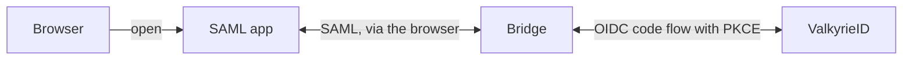

# Protect a SAML app

This guide is for apps that only accept SAML 2.0 logins. If your app supports OpenID Connect, register it as a client instead (see [Sign in users](/guide/sign-in-users)). For apps with only HTTP basic auth or no sign-in of their own, see [Protect an app with oauth2-proxy](/guide/protect-an-app-oauth2-proxy).

[valkyrie-saml-bridge](https://github.com/ValkyrieID/Valkyrie-saml-bridge) does the work. It is a SAML identity provider towards the app and an OpenID Connect client of ValkyrieID. Users sign in with ValkyrieID, and the bridge issues a signed SAML assertion to the app. The app never talks to ValkyrieID.



The bridge's [flows](https://samlbridge.liesel.dev/flows) page has the detailed SP-initiated and IdP-initiated sequences.

The examples use `sso.example.com` for the bridge and `id.example.com` for ValkyrieID. Replace them with your own names.

## 1. Register the bridge in ValkyrieID

```sh
valkyrieid client create saml-bridge --grant authorization_code \
  --redirect-uri https://sso.example.com/saml/callback \
  --scope openid --scope profile --scope email
```

- The bridge is a confidential client. Store the printed `client_secret` where the bridge runs.
- The redirect URI is `{SAMLBRIDGE_PUBLIC_URL}/saml/callback` and must match exactly. ValkyrieID doesn't accept wildcards.
- Allow only the scopes your apps' claims need: `openid` always, and `profile`, `email`, `roles`, or `groups` as needed. ValkyrieID puts the claims for granted scopes into the ID token, which is where the bridge reads them. If a scope isn't allowed, its claims aren't issued.
- No extra flags are needed. PKCE (`S256`) is required by default, and the bridge authenticates to the token endpoint with `client_secret_basic`, which every ValkyrieID confidential client accepts. Don't add `--allow-secret-post` or `--no-pkce`.

The bridge checks ValkyrieID's discovery document at startup and at each login. ValkyrieID meets its rules: it signs ID tokens with `RS256`, includes `auth_time`, and sends `iss` in every authorization response (RFC 9207). The bridge asks with `prompt=none` first, and only shows the sign-in page when there is no ValkyrieID session.

## 2. Run the bridge

The bridge has no published image. Clone the repository and build it locally; its `compose.yaml` builds `valkyrie-saml-bridge:local` and runs it behind Caddy, which terminates TLS. Only Caddy publishes ports.

Create `.env` next to `compose.yaml`, and keep it out of version control:

```sh
SAMLBRIDGE_HOST=sso.example.com
SAMLBRIDGE_PUBLIC_URL=https://sso.example.com
SAMLBRIDGE_MASTER_KEY=<base64 of 32 random bytes>
SAMLBRIDGE_OIDC_ISSUER=https://id.example.com
SAMLBRIDGE_OIDC_CLIENT_ID=saml-bridge
SAMLBRIDGE_OIDC_CLIENT_SECRET=<saml-bridge secret>
```

- `SAMLBRIDGE_PUBLIC_URL` is the bridge's `https` origin, with no path. It sets the entity ID and every endpoint URL. Keep it in step with `SAMLBRIDGE_HOST`, which Caddy uses for its certificate; the bridge doesn't check this.
- `SAMLBRIDGE_MASTER_KEY` encrypts the bridge's signing key. Generate it once with `openssl rand -base64 32` and keep a copy somewhere safe. Losing it makes the signing keys unrecoverable.
- `SAMLBRIDGE_OIDC_ISSUER` must equal ValkyrieID's issuer exactly.
- The bridge reads settings from environment variables only, and refuses the master key and client secret on the command line.

Start it:

```sh
docker compose up -d --build
curl -I https://sso.example.com/healthz
```

The health check returns `200` once Caddy has its certificate. The host name must resolve to the machine, and ports 80 and 443 must be reachable. See the bridge's [Docker](https://samlbridge.liesel.dev/docker) and [configuration](https://samlbridge.liesel.dev/configuration) pages for the details.

## 3. Register an app

Give the app the bridge's metadata URL, `https://sso.example.com/saml/metadata`, and download the app's SP metadata from a source you trust. Copy it into the bridge's data volume, then register it with the `admin` command inside the container:

```sh
docker compose exec saml-bridge admin apps add --slug payroll --metadata /data/payroll.xml
docker compose exec saml-bridge admin apps confirm payroll --fingerprint AB:CD:...
docker compose exec saml-bridge admin apps set payroll \
  --nameid-claim sub --nameid-format persistent \
  --attribute "email=email,required" --enable
```

- `apps add` prints the SHA-256 fingerprint of each signing certificate in the metadata. Check them against the app vendor's documentation, then pass every one to `apps confirm`.
- `--nameid-claim sub` uses ValkyrieID's immutable user id as the SAML subject.
- `--attribute` maps a SAML attribute to an ID token claim. Without `--scope`, the bridge requests `openid` plus `profile` and `email` as the claims need; `roles` and `groups` are only requested when named with `--scope`.
- `--enable` is refused until the NameID is set and every certificate is confirmed.

Users can also start at `https://sso.example.com/idp/payroll` (IdP-initiated). See the bridge's [CLI](https://samlbridge.liesel.dev/cli) and [SSO](https://samlbridge.liesel.dev/sso) pages for the rest.

## Limits

- **No single logout.** Signing out of ValkyrieID doesn't end app sessions, and signing out of an app doesn't end the ValkyrieID session. Use short session lifetimes at the app.
- **Metadata changes** need the app to be removed and added again, and its settings set again.
- **Signing key rotation** needs every app to trust the new certificate before the old one is retired. See [Rotate the signing key](https://samlbridge.liesel.dev/cli#rotate-the-signing-key).
- **No rate limit.** The bridge doesn't limit request rates; put it behind a proxy or firewall that does.

## Related

- [Apps without OpenID Connect](/guide/protect-an-app): other ways to put an app behind ValkyrieID.
- [Protect an app with oauth2-proxy](/guide/protect-an-app-oauth2-proxy): for apps with no sign-in of their own.
- [valkyrie-saml-bridge documentation](https://samlbridge.liesel.dev) and [source](https://github.com/ValkyrieID/Valkyrie-saml-bridge).
