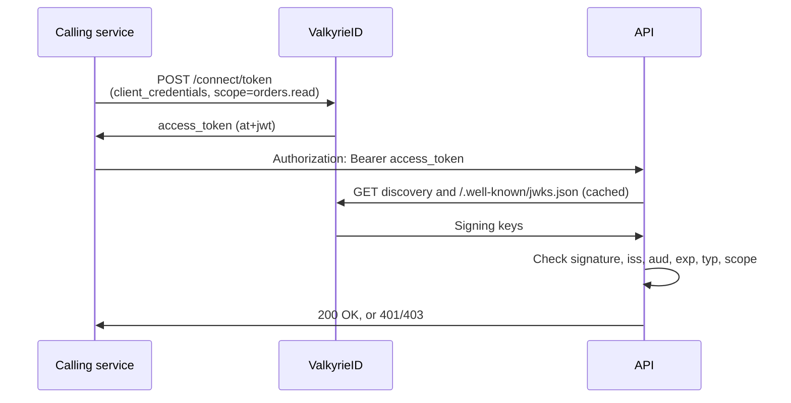
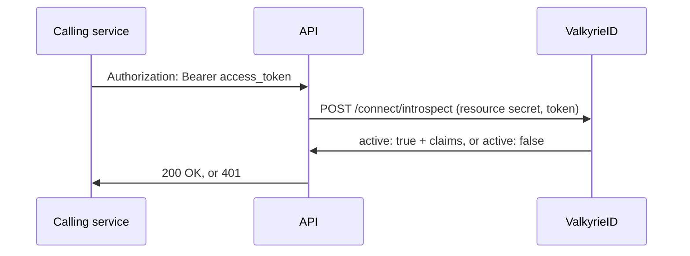

# Protect an API

This guide protects an ASP.NET Core API with access tokens issued by ValkyrieID, and calls it from a service using the `client_credentials` grant.

The service gets a token, and the API validates it locally with the published signing keys:



## 1. Register the API and the calling service

```sh
valkyrieid resource create orders-api --scope orders.read --scope orders.write
valkyrieid client create billing --scope orders.read
```

`client create` prints the `client_secret` once. Store it in the calling service's secret store.

## 2. Validate tokens in the API

```csharp
builder.Services.AddAuthentication(JwtBearerDefaults.AuthenticationScheme)
    .AddJwtBearer(options =>
    {
        options.Authority = "https://id.example.com";
        options.Audience = "orders-api";
        options.TokenValidationParameters.ValidTypes = ["at+jwt"];
        options.MapInboundClaims = false;
    });

builder.Services.AddAuthorization(options =>
    options.AddPolicy("orders.read", policy => policy.RequireAssertion(context =>
        context.User.FindFirst("scope")?.Value.Split(' ').Contains("orders.read") == true)));
```

`Authority` makes the handler load discovery and JWKS, and pick up new signing keys automatically. `Audience` must match the API resource name.

## 3. Get a token in the calling service

```sh
curl -u billing:$SECRET https://id.example.com/connect/token \
  -d grant_type=client_credentials -d scope=orders.read
```

Send the `access_token` to the API as `Authorization: Bearer <token>`. Reuse it until shortly before `expires_in` runs out, rather than requesting a new token per call.

See [Endpoints](/reference/endpoints) for the full token endpoint reference.

## Optional: introspect tokens

APIs that prefer asking the server over validating JWTs themselves can use the [introspection endpoint](/reference/endpoints#introspection-endpoint). Give the API resource a secret:

```sh
valkyrieid resource add-secret orders-api
```

```sh
curl -u orders-api:$RESOURCE_SECRET https://id.example.com/connect/introspect -d token=$ACCESS_TOKEN
```

With introspection, the API asks ValkyrieID about each token instead:



The API only sees tokens whose audience includes it. Introspection doesn't make access tokens revocable: they stay active until they expire.
