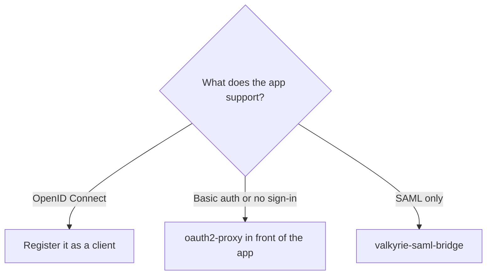

# Apps without OpenID Connect

If an app supports OpenID Connect, register it as a client and let it sign users in itself. See [Sign in users](/guide/sign-in-users).

Many apps don't: they have no sign-in, only HTTP basic auth, or only SAML. ValkyrieID can still protect them, with a small service in front that speaks OpenID Connect to ValkyrieID on the app's behalf. ValkyrieID stays a plain OpenID Connect provider; it doesn't need to know how the app signs users in.

| The app supports | Use | Guide |
|---|---|---|
| OpenID Connect | The app itself | [Sign in users](/guide/sign-in-users) |
| HTTP basic auth, or no sign-in | oauth2-proxy and Caddy | [Protect an app with oauth2-proxy](/guide/protect-an-app-oauth2-proxy) |
| SAML 2.0 only | valkyrie-saml-bridge | [Protect a SAML app](/guide/protect-a-saml-app) |
