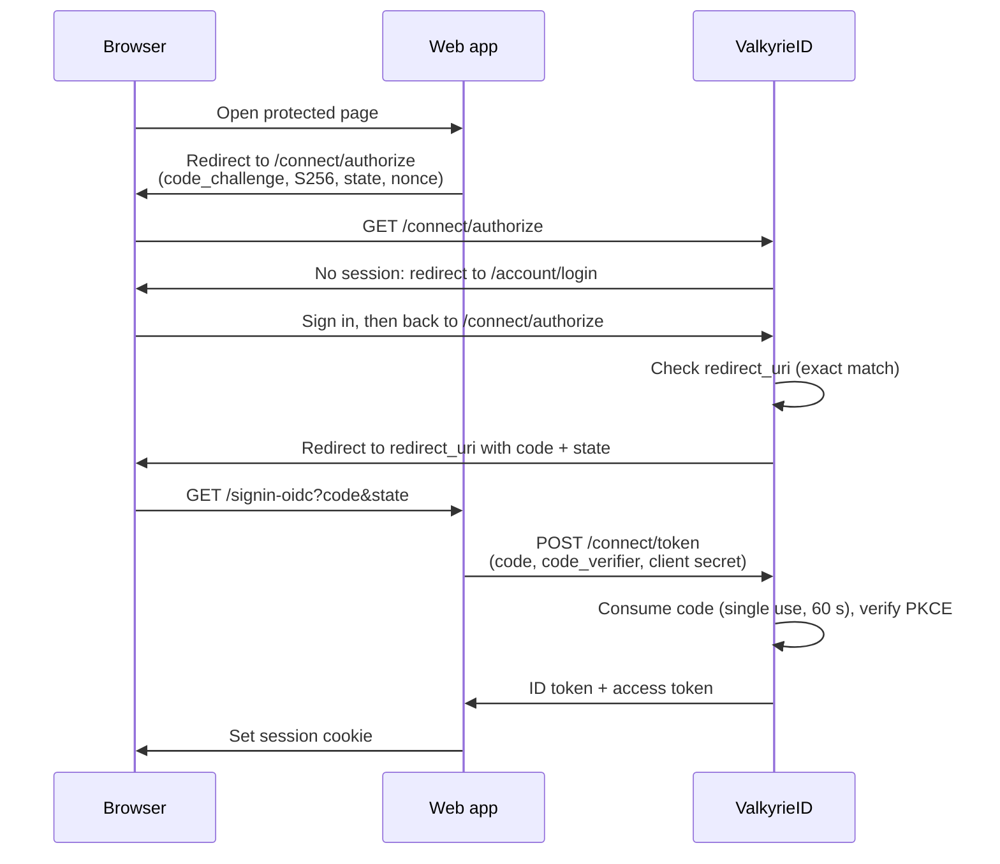
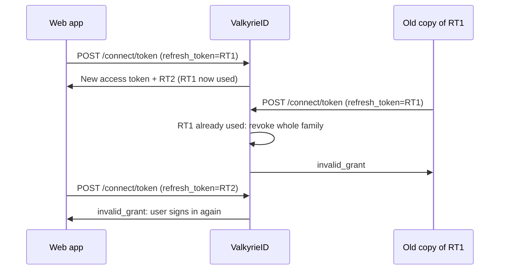

# Sign in users

This guide signs users in to an app with the authorization code flow and PKCE.

## ASP.NET Core web app

Register a confidential client:

```sh
valkyrieid client create webapp --grant authorization_code \
  --redirect-uri https://app.example.com/signin-oidc \
  --scope openid --scope profile --scope email \
  --allow-secret-post
```

The ASP.NET Core handler sends the client secret in the request body (`client_secret_post`) and can't use HTTP Basic, so the client needs `--allow-secret-post`. ValkyrieID refuses `client_secret_post` for other clients, because RFC 6749 §2.3.1 recommends HTTP Basic.

The sign-in uses the authorization code flow with PKCE (RFC 7636, `S256` only):



Configure the app with the printed secret:

```csharp
builder.Services.AddAuthentication(options =>
    {
        options.DefaultScheme = CookieAuthenticationDefaults.AuthenticationScheme;
        options.DefaultChallengeScheme = OpenIdConnectDefaults.AuthenticationScheme;
    })
    .AddCookie()
    .AddOpenIdConnect(options =>
    {
        options.Authority = "https://id.example.com";
        options.ClientId = "webapp";
        options.ClientSecret = builder.Configuration["Oidc:ClientSecret"];
        options.ResponseType = "code";
        options.UsePkce = true;
        options.Scope.Add("profile");
        options.Scope.Add("email");
        options.MapInboundClaims = false;
        options.TokenValidationParameters.NameClaimType = "preferred_username";
    });
```

The ID token already contains the profile and email claims, so calling userinfo is optional.

### Keep users signed in with refresh tokens

To call APIs after the access token expires, allow the client refresh tokens and request `offline_access`:

```sh
valkyrieid client create webapp --grant authorization_code --grant refresh_token \
  --redirect-uri https://app.example.com/signin-oidc \
  --scope openid --scope profile --scope email --scope offline_access \
  --allow-secret-post
```

```csharp
options.Scope.Add("offline_access");
options.SaveTokens = true;
```

Each refresh returns a new refresh token; always store the newest one. Sending an old one again revokes all of them and the user has to sign in again. See [Refresh tokens](/reference/endpoints#refresh-token-grant).

Rotation and reuse detection follow RFC 9700 §4.14:



### Sign out

Register where users land after signing out, and optionally a back-channel logout URI:

```sh
valkyrieid client add-post-logout-redirect-uri webapp https://app.example.com/signout-callback-oidc
valkyrieid client set-backchannel-logout-uri webapp https://app.example.com/backchannel-logout
```

Sign out of both the app and ValkyrieID:

```csharp
app.MapPost("/logout", () => Results.SignOut(
    new AuthenticationProperties { RedirectUri = "/" },
    [CookieAuthenticationDefaults.AuthenticationScheme, OpenIdConnectDefaults.AuthenticationScheme]));
```

The handler sends the user to the [end session endpoint](/reference/endpoints#end-session-endpoint). With `options.SaveTokens = true` it includes the ID token as `id_token_hint`, which lets ValkyrieID send the user back to your app afterwards. ValkyrieID always asks the user to confirm the sign-out.

ASP.NET Core has no built-in back-channel logout receiver. The endpoint at the back-channel logout URI must validate the `logout_token` (signature, `iss`, `aud`, `exp`, the `events` claim, no `nonce`) and end the app's sessions for its `sid`, for example by keeping cookie sessions in a server-side `ITicketStore`. It should respond `200` even if the session is already gone. See [Back-channel logout](/reference/endpoints#back-channel-logout).

## Single-page app

Register a public client. Public clients have no secret and always use PKCE:

```sh
valkyrieid client create spa --public --grant authorization_code \
  --redirect-uri https://spa.example.com/callback \
  --cors-origin https://spa.example.com \
  --scope openid --scope profile --scope orders.read
```

`--cors-origin` lets the browser call the token, userinfo, and revocation endpoints. With [oidc-client-ts](https://github.com/authts/oidc-client-ts):

```ts
const userManager = new UserManager({
  authority: 'https://id.example.com',
  client_id: 'spa',
  redirect_uri: 'https://spa.example.com/callback',
  response_type: 'code',
  scope: 'openid profile orders.read',
})
```

The access token's audience is the API resources that own the requested API scopes (here `orders-api`). See [Protect an API](/guide/protect-an-api).

## Native and CLI apps

Register a loopback redirect URI such as `http://127.0.0.1/callback`. Any port is accepted at sign-in, so the app can listen on an ephemeral port.
